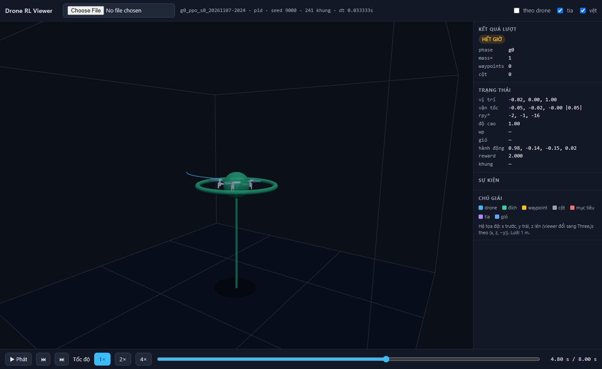
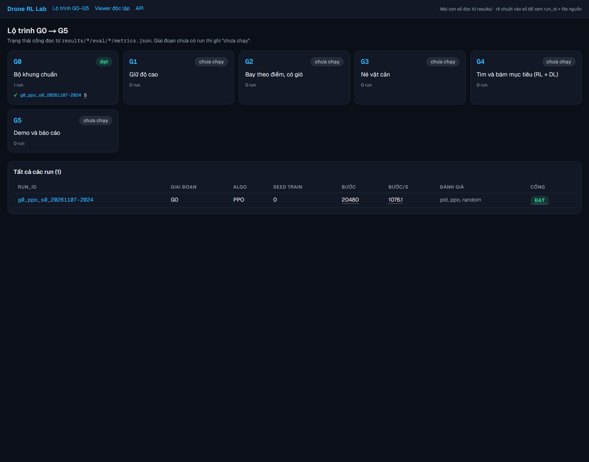
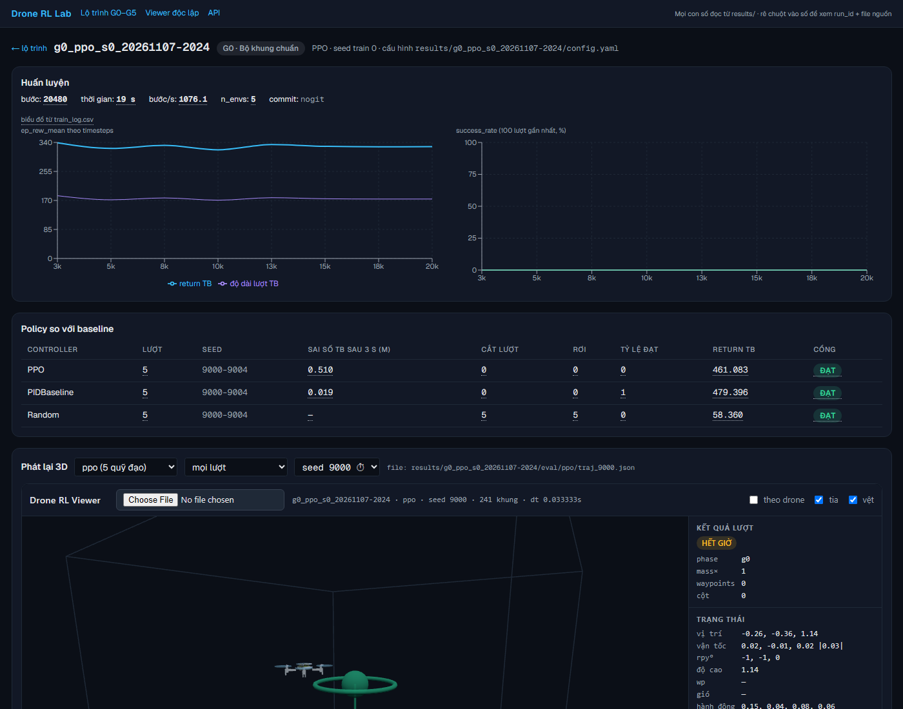

## Báo cáo G0: Bộ khung chuẩn
<!-- gate:start -->
- PPO: quy tắc `n_episodes >= 5.0`, giá trị từng seed = 5, trung bình = 5 → **ĐẠT**; seed kém nhất: `g0_ppo_s0_20261107-2024` (5, rơi 0 lượt)
  - điều kiện phụ (kiểm tay): pytest xanh
  - điều kiện phụ (kiểm tay): train 20000 bước không lỗi
  - điều kiện phụ (kiểm tay): viewer mở được quỹ đạo
<!-- gate:end -->

Cổng 0 là cổng kiểm tự động của bộ khung (pytest xanh, train 20 000 bước không lỗi, evaluate ra metrics + quỹ đạo, viewer mở được file). Dòng "ĐẠT" ở trên sinh từ `results/g0_ppo_s0_20261107-2024/eval/ppo/metrics.json` bằng `scripts/make_report.py --phase g0 --inject docs/report_G0.md`. Policy PPO 20 000 bước **chưa học được gì** (không phải mục tiêu của G0); con số của nó chỉ để chứng minh vòng train → đánh giá → xem lại chạy trọn.

### Giả định (người dùng chưa trả lời 4 câu hỏi)
- Máy: Ryzen 5 4600H 6 nhân, 31 GB RAM, Windows 11, có RTX 3050 nhưng **không dùng** (torch CPU). Không có Conda → Python 3.12 bằng `uv venv` (thư viện main yêu cầu ^3.12). Chi tiết `docs/machine.md`.
- Nhiệm vụ cuối, phạm vi (chỉ mô phỏng), không drone thật: theo bảng mặc định mục 1 của prompt.
- Dashboard G5 dùng **Next.js + Three.js** (react-three-fiber) thay cho Vite theo yêu cầu riêng của người dùng; `ui_reference.html` không có trong thư mục nên bố cục/màu tự chọn (nền tối, panel phải, thanh phát bên dưới).

### Lệnh đã chạy (nguyên văn, thời gian thật 2026-11-07, +07)
```
$ uv venv .venv --python 3.12.12
$ uv pip install --python .venv/Scripts/python.exe pybullet==3.2.7 --no-cache     # build sdist bằng MSVC 14.51, ~6 phút
$ uv pip install --python .venv/Scripts/python.exe torch --index-url https://download.pytorch.org/whl/cpu
$ uv pip install --python .venv/Scripts/python.exe "stable-baselines3[extra]" gymnasium pyyaml pydantic tensorboard pytest fastapi "uvicorn[standard]" onnxruntime ultralytics opencv-python-headless pandas matplotlib transforms3d control pettingzoo scipy pillow
$ uv pip install --python .venv/Scripts/python.exe -e third_party/gym-pybullet-drones --no-deps
$ uv pip freeze --python .venv/Scripts/python.exe > requirements.lock.txt           # 86 gói

$ .venv/Scripts/python.exe third_party/gym-pybullet-drones/gym_pybullet_drones/examples/pid.py --gui False --plot False --duration_sec 3 --user_debug_gui False --output_folder results/_library_example
[INFO] BaseAviary.__init__() loaded parameters from the drone's .urdf:
real    0m4.805s
exit=0
save-flight-11.07.2026_20.14.44.npy

$ .venv/Scripts/python.exe scripts/library_values.py
MAX_SPEED_KMH 30.0 -> SPEED_LIMIT (m/s) = 0.25
CTRL_FREQ 30 PYB_FREQ 240 PYB_STEPS_PER_CTRL 8
obs space (1, 72) act space (1, 4) ACTION_BUFFER_SIZE 15
M 0.027 L 0.0397 KF 3.16e-10 KM 7.94e-12 HOVER_RPM 14468.429183500699 MAX_RPM 21702.64377525105
COLLISION_R 0.06 COLLISION_H 0.025 COLLISION_Z_OFFSET 0.0
EPISODE_LEN_SEC 8 TARGET_POS [0 0 1]
reset obs[:12] [ 0. 0. 0.112 0. -0. 0. 0. 0. 0. 0. 0. 0. ] info {'answer': 42}
ValueError: in BaseAviary.__init__(), PyBullet and control frequencies incompatible with the desired video capture frame rate (24.000000Hz)
   (IMG_RES = [64, 48] ghi cứng; ObservationType.RGB không dùng được với ctrl_freq 30 → G4 tự render, xem library_notes.md)

$ .venv/Scripts/python.exe scripts/bench_env.py --config configs/g0_smoke.yaml --steps 3000
  "steps_per_sec_1env_hover": 1210.8, "steps_per_sec_1env_random": 687.2, "resets_in_random_run": 58, "reset_ms": 36.7,
  "n_envs": 5, "steps_per_sec_nenv_hover": 3266.1, "steps_per_sec_nenv_random": 946.0

$ .venv/Scripts/python.exe scripts/calibrate.py            # → docs/calibration.json (speed_limit ↔ nghiêng, c_d gió)

$ .venv/Scripts/python.exe train.py --config configs/g0_smoke.yaml --seed 0
[train] g0_ppo_s0_20261107-2024: PPO n_envs=5 total_steps=20000 obs_dim=(12,)
[train] xong 20480 bước trong 19s (1076.1 bước/s) -> results\g0_ppo_s0_20261107-2024
real    0m43.212s
$ ls results/g0_ppo_s0_20261107-2024
config.yaml  model.zip  tb/  train_log.csv  train_meta.json  vecnormalize.pkl

$ for c in random pid ppo; do .venv/Scripts/python.exe evaluate.py --run results/g0_ppo_s0_20261107-2024 --controller $c --episodes 5; done
gate G0: n_episodes >= 5.0 -> value=5 passed=True
ghi results\g0_ppo_s0_20261107-2024\eval\random\metrics.json (5 quỹ đạo, 0.35 s)
ghi results\g0_ppo_s0_20261107-2024\eval\pid\metrics.json (5 quỹ đạo, 1.15 s)
ghi results\g0_ppo_s0_20261107-2024\eval\ppo\metrics.json (5 quỹ đạo, 1.71 s)

$ .venv/Scripts/python.exe scripts/screenshot_viewer.py results/g0_ppo_s0_20261107-2024/eval/pid/traj_9000.json docs/screenshots/viewer_g0_pid_9000.png
64307 bytes written to file .../docs/screenshots/viewer_g0_pid_9000.png   (Chrome headless, xem ảnh bên dưới)

$ .venv/Scripts/python.exe -m pytest
..................                                                       [100%]
18 passed in 11.53s          (chạy sau khi file báo cáo này có bảng; test_report_numbers kiểm từng số trong bảng)

# G5 làm sớm để có dashboard ngay từ G0 (Next.js 16.4.5 + Three.js, FastAPI):
$ cd app/web && npm run build        # ✓ Compiled, Route / (static), /runs/[id] (dynamic); real 0m31.151s
$ cd app/web && npm run lint         # không lỗi
$ .venv/Scripts/uvicorn app.api.main:app --port 8000 ; cd app/web && npx next start -p 3100
  → docs/screenshots/dash_roadmap.png, docs/screenshots/dash_run_g0.png (Chrome headless)
  (cổng 3000 trên máy này đã bị một chương trình khác chiếm, nên dùng 3100)
$ .venv/Scripts/python.exe scripts/record_video.py --traj results/g0_ppo_s0_20261107-2024/eval/pid/traj_9000.json --out results/videos/g0_pid_9000.mp4
  → 241 khung, 960×540, 8.03 s (ffprobe); render TINY_RENDERER mất 55 s
$ .venv/Scripts/python.exe perception/make_dataset.py --n 20 --out <tmp>   # thử sinh dữ liệu YOLO: 20 ảnh, 16 có nhãn, 1.2 s
```

### Kết quả (bảng sinh tự động)
<!-- tables:start -->
| Controller | run / seed train | lượt | sai số TB sau 3 s (m) | cắt lượt | rơi | tỷ lệ đạt | return TB | Cổng |
|---|---|---|---|---|---|---|---|---|
| PPO | `g0_ppo_s0_20261107-2024` | 5 | 0.510 | 0 | 0 | 0 | 461.083 | ĐẠT |
| PIDBaseline | `g0_ppo_s0_20261107-2024` | 5 | 0.019 | 0 | 0 | 1 | 479.396 | ĐẠT |
| Random | `g0_ppo_s0_20261107-2024` | 5 | — | 5 | 5 | 0 | 58.360 | ĐẠT |

Nguồn: `results/g0_ppo_s0_20261107-2024/eval/pid/metrics.json`, `results/g0_ppo_s0_20261107-2024/eval/ppo/metrics.json`, `results/g0_ppo_s0_20261107-2024/eval/random/metrics.json`
<!-- tables:end -->

Đo tốc độ mô phỏng: xem bảng trong `docs/machine.md` (1 env 1 210.8 bước/s khi giữ yên; 5 env 3 266.1 bước/s; reset 36.7 ms/lượt). Ước lượng G1: 1.5 M bước × 3 seed ≈ 40 phút.

### Đã thay đổi gì so với config gốc
Xem `docs/experiments.md` (6 dòng ngày 2026-11-07): Python 3.12 thay 3.10; `speed_limit` ghi đè 0.25 → 1.0 (G1) / 1.5 (G2–G4) kèm `max_tilt` 1.2 cho G2–G4; `wind_cd = 0.02`; quan sát G4 15 trường; ra ngoài vùng/nghiêng/va chạm là `terminated`; `SmokeEnv` tái hiện HoverAviary trên giao diện 4.1.

### Quỹ đạo tiêu biểu
- Lượt "thành công" (PID giữ vị trí, sai số sau 3 s nhỏ): `results/g0_ppo_s0_20261107-2024/eval/pid/traj_9000.json` — ảnh viewer: `docs/screenshots/viewer_g0_pid_9000.png`.
- Lượt thất bại (Random, bị cắt vì nghiêng quá 0.4 rad sau chưa đầy 2 s): `results/g0_ppo_s0_20261107-2024/eval/random/traj_9000.json`. Nguyên nhân: hành động ngẫu nhiên đổi hướng mỗi bước làm bộ PID thái độ dao động, roll/pitch vượt ngưỡng cắt của bài toán HoverAviary gốc.



Dashboard (G5 dựng sớm, Next.js + Three.js, đọc qua FastAPI): trang lộ trình và trang chi tiết run — mọi số có gạch chấm, rê chuột hiện `run_id` + file nguồn.




Lưu ý: `train_meta.json` của run G0 ghi `git_commit: nogit` vì run được train trước khi `git init`; các `metrics.json` (chạy sau commit đầu) có hash thật.

### Năm giao diện đã chốt (không đổi sau G0)
1. Env: `envs/base_task.py::BaseTask` (kế thừa `BaseRLAviary`, `reset(seed)->(obs, info)`, `step(a)->(obs, r, term, trunc, info)`, `info` có t/pos/vel/rpy/goal/events/success/crashed/reason, hành động `ActionType.VEL`, `SPEED_LIMIT` từ config).
2. Encoder: `perception/encoders.py::Encoder` protocol (`dim`, `encode(raw)`), `StateEncoder`, `TargetEncoder(source)`.
3. Controller: `agents/controllers.py::Controller` protocol (`name`, `reset(seed)`, `act(obs, info)`), `RandomController`, `PIDBaseline`, `APFBaseline`, `BBoxServoBaseline`, `SB3Controller`.
4. Config: `core/config.py` (pydantic, `extra="forbid"`), YAML trong `configs/`.
5. Kết quả: `results/<run_id>/{config.yaml, model.zip, vecnormalize.pkl, train_log.csv, tb/, eval/<controller>[_<source>]/{metrics.json, traj_<seed>.json}}`; seed train 0–8999, seed đánh giá ≥ 9000 (`evaluate.py` từ chối nếu chồng).

### Vấn đề còn tồn và đề xuất cho giai đoạn sau
- Reset env tốn 36.7 ms (`p.resetSimulation` + nạp URDF); nếu G2–G3 chậm hơn dự kiến có thể đổi sang reset tại chỗ (`resetBasePositionAndOrientation`) nhưng phải giữ nguyên giao diện.
- `SubprocVecEnv` trên Windows (spawn) chỉ tăng ~2.7× với 5 tiến trình; cân nhắc `n_envs` 8–10 nếu lượt dài.
- PPO G0 chưa học (0.51 m sai số sau 20 000 bước) — đúng kỳ vọng; G1 mới là mục tiêu học.
- Viewer đã nạp mesh Crazyflie thật (`viewer/models/cf2.glb` chuyển từ `cf2.dae` của thư viện bằng trimesh); mô hình "người" ở G4 vẫn dựng từ khối.
